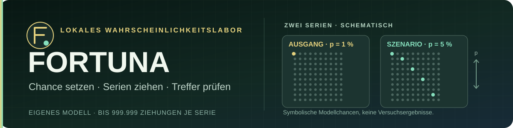

[Deutsch](README.md) · [English](README.en.md) · [Русский](README.ru.md)

# Fortuna · Wahrscheinlichkeiten erproben und Möglichkeiten vergleichen

**Ein lokales Wahrscheinlichkeitslabor und ein getrennter Optionenvergleich.**
Der Glücksversuch zieht mit Web Crypto bis zu **999.999-mal je Serie**. Er
vergleicht eine Ausgangschance mit einer selbst gesetzten Szenariochance und
zeigt die beobachteten Treffer. Daneben lassen sich eigene Optionen eingeben,
Gewichtungen ansehen und die resultierende Rangfolge nachvollziehen. Die
Figuren im Browserraum folgen lokalen Regeln.

**Direkt nutzen:** [FORTUNA im Browser öffnen](https://juri-halveth.github.io/fortuna/).
Die Veröffentlichung führt eigene simulierte Ziehungen im Browser aus. Sie
ändert keine Chancen in fremden Spielen oder Servern und sagt deren Ergebnisse
nicht voraus.

[Modellcode und Prüfpfad](#das-liegt-hier-als-code-vor) · [HALVETH Starship Lab (optional)](https://juri-halveth.github.io/universum/)



**Person: Juri. Projekt: HALVETH.** [Namenszuordnung](IDENTITY.md).

## Das liegt hier als Code vor

„Beispiel vergleichen“ öffnet zwei ausgefüllte Beispieloptionen und berechnet
sofort ihre Auswahl. „Eigene Möglichkeiten“ leert die Beispielwerte. Nach
einer Änderung führt „Vergleich berechnen“ dieselbe Modellrechnung erneut aus.
Auf dem Handy erscheinen die Eingaben als beschriftete Karten. Die vollständige
Liste der 70 Modellprofile und Gewichte ist zusätzlich aufklappbar.

„Glücksversuch starten“ öffnet das getrennte Wahrscheinlichkeitslabor. Zwei
Serien verwenden die eingestellten Chancen und dieselbe Anzahl von Ziehungen,
die das Modell als unabhängig voraussetzt. Bei 999.999 je Serie sind es
insgesamt 1.999.998 lokale Ziehungen.
Eine Ergebnisleiste zeigt die gezählten Treffer. Der Versuch lässt sich
abbrechen; ein Abbruch erzeugt kein fertiges Ergebnis. Die Dezimalchance hat
höchstens neun Nachkommastellen. Rejection Sampling vermeidet einen Modulo-Bias
bei der Umrechnung von Web-Crypto-Zufallszahlen auf eine Milliarde Werte.

- `docs/collective.mjs`: transparente Bewertung gelieferter Optionen und Gewichte.
- `docs/rng-lab.mjs`: gekapselte lokale Ziehungen und exakte Eingabegrenzen.
- `docs/rng-panel.mjs`: direkt bedienbares Labor mit Fortschritt und Abbruch.
- `docs/curiosity.mjs`: lokale Verhaltensregeln für die Figuren.
- `docs/index.html`: Browseroberfläche mit Erkundungsraum und Detailansicht.
- Die zugehörigen Tests unter `docs/` prüfen die implementierten Verträge.

## Lokal starten

```sh
node --test docs/*.test.mjs
python -c "import http.server, os; os.chdir('docs'); http.server.SimpleHTTPRequestHandler.extensions_map['.mjs']='text/javascript'; http.server.test(HandlerClass=http.server.SimpleHTTPRequestHandler,port=8849,bind='127.0.0.1')"
```

Danach `http://127.0.0.1:8849/` öffnen.
Die Modul-Zuordnung ist ausdrücklich gesetzt, damit die Vorschau auch mit einer
abweichenden Windows-MIME-Registrierung JavaScript-Module ausführt.

## Reifegrad und Herkunft

Der veröffentlichte Bestand ist eine **Browserfassung**. Das früher beschriebene
lokale Windows-Projekt für Fensterorganisation besitzt in diesem Repository
weder einen veröffentlichten nativen Quellstand noch einen EXE-Download.

Die Bewertungen berechnen Rangfolgen aus Eingaben. Sie sind keine gemessene
Verbesserung externer Gewinnchancen. Alle Figuren verwenden lokale Regeln;
70 Ausgaben sind keine 70 unabhängig trainierten KI-Systeme.
Die Ziehungsserie ist ein eigenes Bernoulli-Modell. Ihr `Szenario`-Wert ändert
nur dieses Modell, nicht die Wahrscheinlichkeit eines externen Ereignisses.

Die kopierten Figuren und Daten stammen aus der Scarlet-Quellfassung
`15f5df46e20e34bc06bc7d7676c7fd094ebb39f4`. [Komponentenhinweise](docs/NOTICE.md).
Eine abschließende eigene Projektlizenz ist noch nicht erteilt; Fremdkomponenten
behalten ihre Bedingungen. Öffentliche Sichtbarkeit allein ist keine freie Lizenz.

Projektleitung: **Juri / HALVETH**. Entwicklung mit KI-Unterstützung.
Kontakt: **security@halveth.de**.
